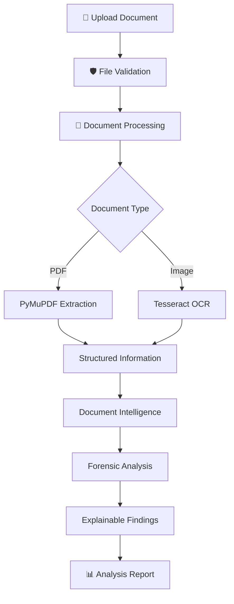

 <div align="center">

# 🛡️ SCAMSCAN 2.0

### DIGITAL TRUST & DOCUMENT FORENSICS PLATFORM


<p>
  <strong>Turning Digital Documents Into Investigable Evidence.</strong>
</p>

<p>
  An AI-powered platform designed to extract, examine and explain digital document information through OCR, document intelligence and forensic analysis.
</p>

<br/>

<a href="https://github.com/MrAryanKode/SCAMSCAN-NEXT">
  
</a>


<br/><br/>

<a href="https://github.com/MrAryanKode/SCAMSCAN-NEXT/stargazers">
  
</a>
<a href="https://github.com/MrAryanKode/SCAMSCAN-NEXT/network/members">
  
</a>
<a href="https://github.com/MrAryanKode/SCAMSCAN-NEXT/commits/main">
  
</a>

</div>

---

## ◈ THE VISION

Digital documents are everywhere. But how much can we actually trust them?

ScamScan 2.0 is being developed as a **Digital Trust & Document Forensics Platform** that helps users examine documents, extract information and identify potentially suspicious characteristics.

Our objective is to transform raw document data into understandable, structured and explainable forensic findings.

**We don't just read documents. We aim to understand them.**

---

## ⚡ CORE CAPABILITIES

<table>
<tr>
<td width="50%" valign="top">

### 📄 Intelligent Document Processing

- PDF and image uploads
- Multi-page PDF extraction
- OCR-based text recognition
- Document information extraction
- File validation

</td>
<td width="50%" valign="top">

### 🔬 Digital Forensics

- Error Level Analysis (ELA)
- Image metadata inspection
- Compression analysis
- Edge and noise analysis
- PDF structure inspection

</td>
</tr>
<tr>
<td width="50%" valign="top">

### 🧠 Document Intelligence

- Name and date extraction
- Financial information extraction
- Missing-field detection
- Document consistency checks
- Explainable findings

</td>
<td width="50%" valign="top">

### 🤖 AI Forensic Assistant

- Human-readable explanations
- Evidence-grounded analysis
- Risk interpretation
- Verification recommendations
- Context-aware document assistance

</td>
</tr>
</table>

> **Development note:** These are planned platform capabilities. Features are progressively implemented and tested. Only completed features are marked as operational below.

---

## 🟢 IMPLEMENTATION STATUS

| Component | Status |
|---|---|
| FastAPI backend foundation | ✅ Implemented |
| Health check API | ✅ Implemented |
| Document upload API | ✅ Implemented |
| File signature validation | ✅ Implemented |
| 15 MB upload limit | ✅ Implemented |
| Tesseract OCR integration | ✅ Implemented |
| PDF text extraction | ✅ Implemented |
| Multi-page PDF processing | ✅ Implemented |
| Structured document intelligence | 🔄 Planned |
| Document consistency engine | 🔄 Planned |
| Image forensic analysis | 🔄 Planned |
| PDF metadata analysis | 🔄 Planned |
| AI forensic assistant | 🔄 Planned |
| Frontend dashboard | 🔄 Planned |
| Secure authentication | 🔄 Planned |

---

## 🏗️ TECHNOLOGY STACK

<div align="center">

### Backend & Processing


### Document Intelligence


### Development & Version Control


</div>

---

## 🔄 HOW SCAMSCAN WORKS



---

## 📂 PROJECT STRUCTURE

```text
SCAMSCAN-NEXT/
│
├── backend/
│   ├── main.py
│   ├── uploads/
│   └── venv/
│
├── frontend/
│
├── docs/
│
├── .gitignore
└── README.md
```

*Note: Virtual environments and uploaded documents are excluded from Git using `.gitignore`.*

---

## 🚀 GETTING STARTED

### 1. Clone the repository

```bash
git clone https://github.com/MrAryanKode/SCAMSCAN-NEXT.git
cd SCAMSCAN-NEXT
```

### 2. Navigate to backend

```bash
cd backend
```

### 3. Create a virtual environment

```bash
python -m venv venv
```

### 4. Activate the environment

**Windows PowerShell:**

```powershell
.\venv\Scripts\Activate.ps1
```

### 5. Install dependencies

```bash
python -m pip install fastapi "uvicorn[standard]" python-multipart pytesseract pillow pymupdf
```

### 6. Install Tesseract OCR

Install Tesseract OCR separately on your operating system.

For Windows:

[Download Tesseract OCR](https://github.com/UB-Mannheim/tesseract/wiki)

Configure the Tesseract executable path in the backend configuration.

### 7. Start the development server

```bash
uvicorn main:app --reload
```

### 8. Open API documentation

| Service | URL |
|---|---|
| Backend | http://127.0.0.1:8000 |
| Swagger UI | http://127.0.0.1:8000/docs |
| Health Check | http://127.0.0.1:8000/api/health |

---

## 🔌 AVAILABLE API ENDPOINTS

| Method | Endpoint | Description |
|---|---|---|
| GET | `/` | API information |
| GET | `/api/health` | Backend health check |
| POST | `/api/upload` | Upload and validate documents |
| POST | `/api/ocr` | Extract document text |

All endpoints are available through interactive Swagger documentation.

---

## 🧪 DEVELOPMENT PHILOSOPHY

ScamScan is being built around five principles:

1. **Evidence First:** Every finding should be traceable to actual document evidence.
2. **Explainability:** Users should understand why a document characteristic is flagged.
3. **Security:** Uploaded documents and user information must be handled carefully.
4. **Reliability:** Document processing should handle malformed, unsupported and oversized files safely.
5. **Transparency:** Automated analysis must communicate uncertainty and limitations.

---

## 🗺️ DEVELOPMENT ROADMAP

- [x] Backend foundation
- [x] Upload API
- [x] OCR integration
- [x] PDF text extraction
- [ ] Document Intelligence Engine
- [ ] Structured field extraction
- [ ] Document Consistency Engine
- [ ] Image Forensics Engine
- [ ] PDF Metadata Analyzer
- [ ] QR and Barcode Analysis
- [ ] Evidence-based Risk Engine
- [ ] AI Forensic Assistant
- [ ] Secure User Dashboard
- [ ] Analysis History
- [ ] PDF Forensic Reports
- [ ] Production Deployment

---

## 🔐 SECURITY & RESPONSIBLE USE

ScamScan is designed to assist document examination, not to declare documents definitively genuine or fraudulent.

- Automated indicators are not proof of manipulation.
- OCR output may contain recognition errors.
- Metadata can be missing or modified.
- Findings require appropriate human interpretation and verification.
- Sensitive documents should not be uploaded to public repositories.

---

## 👨‍💻 DEVELOPER

<div align="center">

<a href="https://github.com/MrAryanKode">
  
</a>

### Aryan Gupta

**Founder & Developer — ScamScan 2.0**

Building technology for digital trust, document intelligence and forensic analysis.

<a href="https://github.com/MrAryanKode">
  
</a>

<a href="https://github.com/MrAryanKode/SCAMSCAN-NEXT">
  
</a>

</div>

---

<div align="center">

### 🛡️ SCAMSCAN 2.0

**ANALYZE. INVESTIGATE. UNDERSTAND.**

<sub>Built with curiosity, engineering and a commitment to digital trust.</sub>

</div>