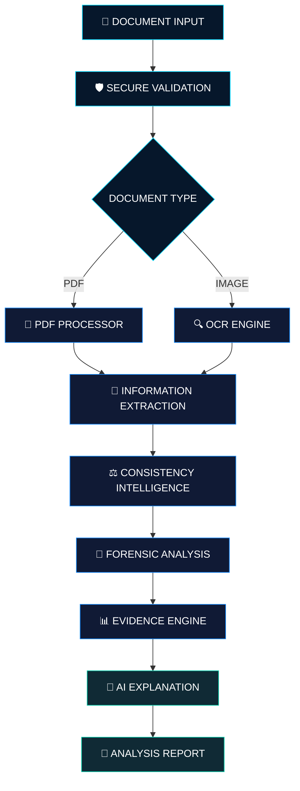

<div align="center">


<br/>


<br/><br/>

### 🛡️ THE NEXT GENERATION OF DIGITAL DOCUMENT INVESTIGATION

<p>
  <i>Every document tells a story. We investigate what lies beneath.</i>
</p>

<br/>

<a href="https://github.com/MrAryanKode/SCAMSCAN-NEXT">

</a>
<a href="https://github.com/MrAryanKode/SCAMSCAN-NEXT/commits/main">

</a>
<a href="https://github.com/MrAryanKode/SCAMSCAN-NEXT/issues">

</a>

<br/><br/>


</div>

<br/>

<table>
<tr>
<td width="65%" valign="middle">

## 🌌 BEYOND DOCUMENT SCANNING

Documents are becoming increasingly digital. So are the methods used to manipulate them.

**ScamScan 2.0** is an AI-powered Digital Trust & Document Forensics Platform being engineered to examine documents, extract information, investigate suspicious characteristics and generate explainable findings.

We combine document intelligence, OCR, digital image forensics and evidence-based analysis into one unified platform.

**Our mission is simple: Make digital document examination more intelligent, transparent and accessible.**

</td>
<td width="35%" align="center" valign="middle">


<br/><br/>


<br/><br/>


</td>
</tr>
</table>

---

<div align="center">

## ⚡ THE INTELLIGENCE ECOSYSTEM

<sub>FOUR PILLARS. ONE DIGITAL TRUST PLATFORM.</sub>

</div>

<table>
<tr>
<td width="50%" valign="top">

### 📄 01 — DOCUMENT INTELLIGENCE

Extract meaningful information from complex digital documents.

- 🔍 OCR text extraction
- 📑 Multi-page PDF processing
- 🧠 Structured field extraction
- 👤 Name and date recognition
- 💰 Financial information extraction
- ⚠️ Missing-field detection

</td>
<td width="50%" valign="top">

### 🔬 02 — DIGITAL FORENSICS

Investigate digital characteristics that may indicate manipulation.

- 🧬 Error Level Analysis
- 🖼️ Image metadata inspection
- 📊 Compression analysis
- 🔎 Edge and noise analysis
- 📑 PDF structure inspection
- 🧩 Embedded image examination

</td>
</tr>
<tr>
<td width="50%" valign="top">

### 🧠 03 — CONSISTENCY INTELLIGENCE

Identify conflicting information across document fields.

- ⚖️ Cross-field validation
- 📅 Date inconsistency detection
- 💳 Amount verification
- 🔗 Duplicate reference detection
- 🚩 Missing information
- 📋 Evidence-based findings

</td>
<td width="50%" valign="top">

### 🤖 04 — AI FORENSIC ASSISTANT

Turn complex forensic findings into understandable explanations.

- 💬 Natural-language explanations
- 🧠 Context-aware assistance
- 📊 Risk interpretation
- 🔍 Evidence-grounded answers
- 🛡️ Verification recommendations
- 📑 Report assistance

</td>
</tr>
</table>

---

<div align="center">

## 🔄 INSIDE THE SCAMSCAN ENGINE

<sub>FROM RAW DOCUMENTS TO EXPLAINABLE FORENSIC FINDINGS</sub>

</div>



---

<div align="center">

## 💎 TECHNOLOGY POWERING SCAMSCAN

<sub>THE ENGINEERING ECOSYSTEM</sub>

<br/><br/>

### ⚙️ BACKEND ENGINEERING


### 🔬 DOCUMENT PROCESSING


### 🧰 DEVELOPMENT TOOLS


</div>

---

## 🚀 LIVE IMPLEMENTATION STATUS

<table>
<tr>
<th>ENGINEERING MODULE</th>
<th>STATUS</th>
</tr>
<tr><td>⚙️ FastAPI backend foundation</td><td>✅ Implemented</td></tr>
<tr><td>💚 API health monitoring</td><td>✅ Implemented</td></tr>
<tr><td>📁 Document upload API</td><td>✅ Implemented</td></tr>
<tr><td>🛡️ File signature validation</td><td>✅ Implemented</td></tr>
<tr><td>🔍 Tesseract OCR integration</td><td>✅ Implemented</td></tr>
<tr><td>📑 Multi-page PDF text extraction</td><td>✅ Implemented</td></tr>
<tr><td>🧠 Structured document intelligence</td><td>✅ Implemented </td></tr>
<tr><td>⚖️ Document consistency engine</td><td>✅ Implemented</td></tr>
<tr><td>🔬 Image forensic engine</td><td>✅ Implemented</td></tr>
<tr><td>📊 Evidence-based risk engine</td><td>✅ Implemented</td></tr>
<tr><td>🤖 AI forensic assistant</td><td>✅ Implemented</td></tr>
<tr><td>🌐 Frontend dashboard</td><td>✅ Implemented</td></tr>
<tr><td>🔐 Authentication and user workspace</td><td>✅ Implemented</td></tr>
</table>

---

<div align="center">

## 🖥️ DEVELOPER COMMAND CENTER

</div>

### 01 — Clone the repository

```bash
git clone https://github.com/MrAryanKode/SCAMSCAN-NEXT.git
cd SCAMSCAN-NEXT
```

### 02 — Create the Python environment

```powershell
cd backend
python -m venv venv
.\venv\Scripts\Activate.ps1
```

### 03 — Install dependencies

```powershell
python -m pip install fastapi "uvicorn[standard]" python-multipart pytesseract pillow pymupdf
```

### 04 — Install Tesseract OCR

Windows installation:

https://github.com/UB-Mannheim/tesseract/wiki

Configure the executable path in the backend.

### 05 — Launch the engine

```powershell
uvicorn main:app --reload
```

<div align="center">

### 🔌 API ACCESS POINTS

| METHOD | ENDPOINT | FUNCTION |
|:---:|:---|:---|
| 🟢 GET | `/` | API information |
| 🟢 GET | `/api/health` | Health monitoring |
| 🔵 POST | `/api/upload` | Document upload |
| 🔵 POST | `/api/ocr` | Text extraction |

<br/>

<a href="http://127.0.0.1:8000/docs">

</a>

</div>

---

## 🧭 ENGINEERING ROADMAP

| MILESTONE | DEVELOPMENT |
|---|---|
| 01 | [x] Backend foundation |
| 02 | [x] Document upload |
| 03 | [x] OCR and PDF extraction |
| 04 | [ ] Structured document intelligence |
| 05 | [ ] Consistency analysis |
| 06 | [ ] Digital image forensics |
| 07 | [ ] PDF metadata inspection |
| 08 | [ ] Evidence-based risk assessment |
| 09 | [ ] AI forensic assistant |
| 10 | [ ] Premium frontend dashboard |
| 11 | [ ] Secure user workspace |
| 12 | [ ] Report generation |
| 13 | [ ] Production deployment |

---

## 🛡️ SECURITY & RESPONSIBLE INTELLIGENCE

ScamScan provides automated document analysis and forensic indicators. It does not independently certify documents as genuine or fraudulent.

- 🔐 Sensitive documents must be handled securely.
- 🧾 Every finding should be connected to actual evidence.
- ⚖️ Automated indicators are not proof of manipulation.
- 🧠 OCR output can contain recognition errors.
- 👨‍⚖️ High-stakes decisions require appropriate human verification.

---

<div align="center">


### 🛡️ BUILT TO INVESTIGATE. DESIGNED TO EXPLAIN.

**Developed by Aryan Gupta**

<a href="https://github.com/MrAryanKode">

</a>

<a href="https://github.com/MrAryanKode/SCAMSCAN-NEXT">

</a>

<sub>THE FUTURE OF DOCUMENT INTELLIGENCE STARTS HERE.</sub>

</div>
