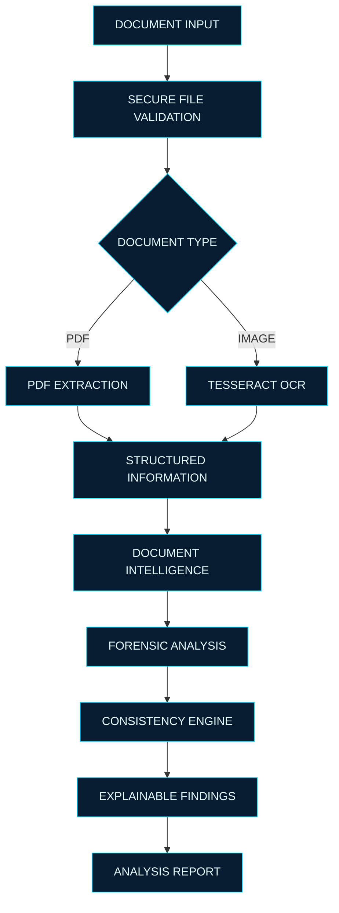

<div align="center">


<p>
  <strong>◈ ANALYZE. INVESTIGATE. UNDERSTAND. ◈</strong>
</p>

<p>
  An AI-powered Digital Trust & Document Forensics Platform
</p>

<br/>


<br/><br/>

<a href="https://github.com/MrAryanKode/SCAMSCAN-NEXT">

</a>
<a href="https://github.com/MrAryanKode/SCAMSCAN-NEXT/commits/main">

</a>
<a href="https://github.com/MrAryanKode/SCAMSCAN-NEXT/issues">

</a>

</div>

---

## `01` — SYSTEM OVERVIEW

**Digital documents can be manipulated. Their contents can be inconsistent. Their metadata can tell a different story.**

ScamScan 2.0 is being developed to help investigate these characteristics through document extraction, consistency analysis and digital forensic techniques.

Our vision is to transform unstructured documents into structured, explainable evidence.

> We don't simply scan documents. We investigate their digital characteristics.

---

## `02` — INTELLIGENCE MODULES

<table>
<tr>
<td width="50%" valign="top">

### ◈ DOCUMENT INTELLIGENCE

- OCR text extraction
- PDF text extraction
- Structured information extraction
- Name and date identification
- Missing-field detection
- Document classification

</td>
<td width="50%" valign="top">

### ◈ DIGITAL FORENSICS

- Error Level Analysis (ELA)
- Image metadata inspection
- Compression analysis
- Edge and noise analysis
- PDF structure inspection
- Digital evidence examination

</td>
</tr>
<tr>
<td width="50%" valign="top">

### ◈ CONSISTENCY ENGINE

- Conflicting information detection
- Amount and date comparisons
- Duplicate reference detection
- Missing information
- Cross-field validation

</td>
<td width="50%" valign="top">

### ◈ AI FORENSIC ASSISTANT

- Evidence-grounded explanations
- Risk interpretation
- Document insights
- Verification recommendations
- Human-readable findings

</td>
</tr>
</table>

*These modules describe the planned platform. Their implementation status is tracked below.*

---

## `03` — PROCESSING ARCHITECTURE



---

## `04` — TECHNOLOGY MATRIX

<div align="center">

**BACKEND ENGINEERING**


**DOCUMENT PROCESSING**


**DEVELOPMENT ECOSYSTEM**


</div>

---

## `05` — IMPLEMENTATION STATUS

| Component | Status |
|---|---|
| FastAPI backend | COMPLETE |
| Health check endpoint | COMPLETE |
| Document upload API | COMPLETE |
| File signature validation | COMPLETE |
| Tesseract OCR integration | IMPLEMENTED |
| PDF text extraction | IMPLEMENTED |
| Multi-page PDF processing | IMPLEMENTED |
| Structured document extraction | PLANNED |
| Document consistency engine | PLANNED |
| Image forensic analysis | PLANNED |
| PDF metadata analysis | PLANNED |
| Explainable risk engine | PLANNED |
| AI forensic assistant | PLANNED |
| Frontend dashboard | PLANNED |
| Authentication and history | PLANNED |

---

## `06` — DEVELOPER QUICK START

### Clone repository

```bash
git clone https://github.com/MrAryanKode/SCAMSCAN-NEXT.git
cd SCAMSCAN-NEXT
```

### Create virtual environment

```bash
cd backend
python -m venv venv
```

### Activate environment

```powershell
.\venv\Scripts\Activate.ps1
```

### Install dependencies

```bash
python -m pip install fastapi "uvicorn[standard]" python-multipart pytesseract pillow pymupdf
```

### Install Tesseract OCR

Windows users can install Tesseract from:

https://github.com/UB-Mannheim/tesseract/wiki

Configure its executable path in the backend.

### Start the backend

```bash
uvicorn main:app --reload
```

### API documentation

| Endpoint | Purpose |
|---|---|
| `/` | API information |
| `/api/health` | Server health |
| `/api/upload` | Document upload |
| `/api/ocr` | Text extraction |

Swagger UI: `http://127.0.0.1:8000/docs`

---

## `07` — ENGINEERING PRINCIPLES

**EVIDENCE FIRST** — Every forensic finding should be connected to actual document evidence.

**EXPLAINABILITY** — Users should understand why a characteristic is flagged.

**SECURITY** — Uploaded documents and sensitive information must be protected.

**RELIABILITY** — Handle corrupted, unsupported and malformed files safely.

**TRANSPARENCY** — Automated findings must communicate uncertainty and limitations.

---

## `08` — DEVELOPMENT ROADMAP

- [x] Backend foundation
- [x] Document upload
- [x] OCR integration
- [x] PDF text extraction
- [ ] Document intelligence engine
- [ ] Structured data extraction
- [ ] Consistency detection
- [ ] Image forensic engine
- [ ] PDF metadata analyzer
- [ ] QR and barcode inspection
- [ ] Evidence-based risk engine
- [ ] AI forensic assistant
- [ ] Frontend dashboard
- [ ] Authentication and user workspace
- [ ] Forensic PDF reports
- [ ] Production deployment

---

## `09` — SECURITY & RESPONSIBLE ANALYSIS

ScamScan is an assistance platform, not a certification authority.

Automated forensic indicators cannot independently establish that a document is genuine or fraudulent. OCR may contain errors, metadata may be altered, and findings require appropriate human interpretation.

---

<div align="center">

### ◈ THE SCAMSCAN INITIATIVE ◈

**ENGINEERED FOR DIGITAL TRUST.**

<br/>

<a href="https://github.com/MrAryanKode">

</a>

<a href="https://github.com/MrAryanKode/SCAMSCAN-NEXT">

</a>

<br/><br/>

<sub>Building the future of document intelligence and digital forensics.</sub>

</div>
